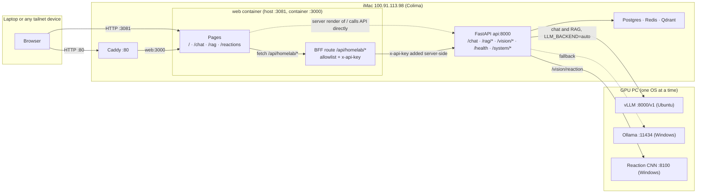
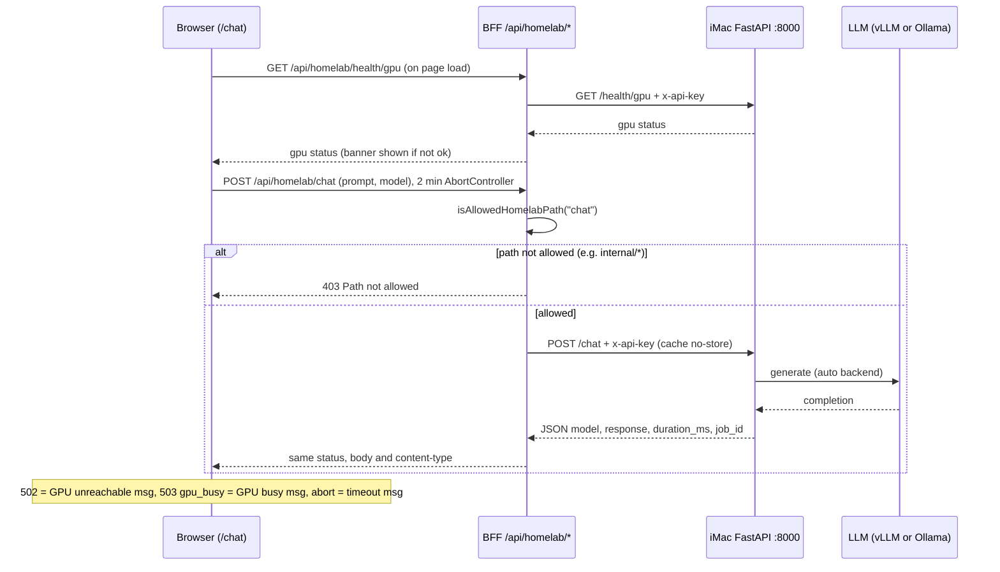

<div align="center">

# homelab-web

**The Next.js web UI for the homelab ML platform: chat, RAG, facial-expression reactions and platform status, served through a server-side proxy so the API key never reaches the browser.**

[](https://github.com/zakiscoding/homelab-web/actions/workflows/ci.yml)    

[homelab](https://github.com/zakiscoding/homelab) (docs hub) · [homelab-services](https://github.com/zakiscoding/homelab-services) · **homelab-web** · [homelab-gpu](https://github.com/zakiscoding/homelab-gpu) · [gpu-systems-lab](https://github.com/zakiscoding/gpu-systems-lab)

</div>

---

> **Branch note:** `main` is the live branch that the iMac deploys. The GitHub default branch is currently `master`, which is stale (initial commit only). Clone or check out `main`.

## What's inside

- **Overview (`/`)**: API health, GPU reachability, Postgres / Redis / Qdrant status and the active RAG collection. Rendered on the server.
- **Chat (`/chat`)**: plain LLM chat (no retrieval) through `POST /chat`, with a GPU health banner and a 2-minute client timeout. The iMac API picks the backend (`LLM_BACKEND=auto`: vLLM on the Ubuntu GPU node if it is up, otherwise Ollama on Windows).
- **RAG (`/rag`)**: ingest text (`/rag/ingest`, auto-embed), ask questions with citations (`/rag/query`, `top_k` 5) and view `/rag/status`.
- **Reactions (`/reactions`)**: facial-expression detection (FER2013 ResNet18) from a webcam frame or an uploaded photo, through `/vision/*` to the reaction CNN on the GPU PC (:8100).
- **BFF proxy (`/api/homelab/*`)**: one route handler that checks the path against an allowlist, adds `x-api-key` on the server and forwards to the FastAPI.
- **Stack**: Next.js 16, React 19, Tailwind CSS 4, TypeScript; `output: "standalone"` Docker image on Node 22.

## Architecture



The overview page (`/`) is a server component and calls the API directly with `homelabFetch`. Chat, RAG and Reactions are client components and go through the BFF route. Either way the key is only read on the server.

### A chat request through the BFF



The proxy itself sets no timeout; the only timeout is the 2-minute `AbortController` in the chat page. Status codes and bodies from the API pass through unchanged.

## Quickstart

### Development (laptop)

Needs Node 22+ and Tailscale up so the iMac is reachable.

```powershell
git clone -b main https://github.com/zakiscoding/homelab-web.git C:\Users\cashh\homelab-web
cd C:\Users\cashh\homelab-web
npm install
copy .env.local.example .env.local
# edit .env.local: set HOMELAB_API_KEY to the API_KEY value from homelab-services/.env on the iMac
npm run dev
```

Open http://localhost:3000. With the example env, requests go to `http://100.91.113.98` (Caddy on the iMac). The webcam on `/reactions` works on `localhost`; photo upload works everywhere.

### Production (iMac)

`homelab-web` must be a sibling of `homelab-services` because the compose build context is `../homelab-web`:

```text
~/1tb-drive/
  homelab-services/
  homelab-web/
```

```bash
cd ~/1tb-drive/homelab-services
git pull
./scripts/ensure-homelab-web.sh          # clone or update ../homelab-web
source ./scripts/docker-1tb-env.sh
./scripts/render-caddyfile.sh
docker-compose up -d --build web caddy
```

Open http://100.91.113.98:3081 or http://100.91.113.98/ (tailnet only). Compose maps `3081:3000`, sets `HOMELAB_API_URL=http://api:8000` and `HOMELAB_API_KEY` from the stack's `API_KEY`; Caddy reverse-proxies to `web:3000`.

### GPU prerequisites

| Feature | Needs | Check |
|---|---|---|
| Chat, RAG | vLLM on the Ubuntu boot, or Ollama on the Windows boot | `curl.exe http://100.88.71.33:11434/api/tags` (Ollama) |
| Reactions | Reaction CNN serve :8100 on the Windows boot | `/reactions` shows the vision status card |

If Ollama is down on Windows: `schtasks /Run /TN HomelabOllamaServe` or `homelab-gpu/scripts/start-ollama.ps1` on zak_pc. See [vision-reactions](https://github.com/zakiscoding/homelab/blob/main/docs/services/vision-reactions.md) for the reaction service.

## Layout

| Path | Purpose |
|---|---|
| `app/page.tsx` | Overview (server component): `/health`, `/health/gpu`, `/system/status` |
| `app/chat/page.tsx` | Chat form, GPU banner, 2-minute timeout, friendly 502 / 503 errors |
| `app/rag/page.tsx` | RAG ingest / query / status tabs |
| `app/reactions/page.tsx` | Webcam (live every 600 ms) or photo upload → `POST /vision/reaction`; `GET /vision/status` |
| `app/reactions/layout.tsx` | Forces dynamic rendering for `/reactions` |
| `app/api/homelab/[...path]/route.ts` | BFF proxy for GET, POST, PUT, PATCH, DELETE |
| `app/layout.tsx`, `app/globals.css` | Root layout, fonts, Tailwind styles |
| `components/shell.tsx` | Page shell and top nav (Overview, Chat, RAG, Reactions) |
| `components/ui.tsx` | `Card`, `Label`, `Input`, `Textarea`, `Button`, `Badge` |
| `lib/config.ts` | Server-only config: API base URL and key |
| `lib/homelab.ts` | Path allowlist, `homelabFetch`, response types |
| `lib/parse-api-response.ts` | Safe JSON parsing and error-detail extraction for non-JSON upstream replies |
| `Dockerfile` | Three-stage Node 22 Alpine build, runs `server.js` as non-root `nextjs` |
| `.env.local.example` | Env template (placeholders only) |
| `AGENTS.md`, `CLAUDE.md` | Notes for coding agents (this Next.js version differs from older docs) |

## Configuration

| Variable | Used by | Default | Notes |
|---|---|---|---|
| `HOMELAB_API_URL` | `lib/config.ts` | `http://100.91.113.98` | FastAPI base URL. In prod compose: `http://api:8000`. Trailing slash is stripped. |
| `HOMELAB_API_KEY` | `lib/config.ts` | empty | Sent as `x-api-key`. Server-side only; never prefix with `NEXT_PUBLIC_`. |

Set them in `.env.local` for dev. `.env*` files are git-ignored and excluded from the Docker build context (except the example).

## Security

- **The API key stays on the server.** Only `lib/config.ts` reads `HOMELAB_API_KEY`, and only server code (the BFF route and the overview page) uses it. Browser code calls relative `/api/homelab/*` URLs and never sees the key.
- **Path allowlist.** The proxy forwards only paths starting with `chat`, `rag/`, `vision/`, `system/`, `health`, `stats`, `jobs` or `models`. Anything under `internal/` (the worker API, which uses `X-Worker-Key`) is rejected with 403.
- **No caching.** Upstream fetches use `cache: "no-store"`.
- **Network.** The UI is for the tailnet only and has no login of its own; anyone who can reach :3081 or Caddy :80 can use the allowed routes.
- **Webcam.** Browsers allow the camera only on HTTPS or `localhost`. Over plain HTTP on the tailnet, use photo upload or an SSH tunnel to `https://localhost:3081`.

## Operations

| Task | Command (on the iMac, in `homelab-services`) |
|---|---|
| Update and rebuild | `./scripts/ensure-homelab-web.sh && docker-compose up -d --build web` |
| Logs | `docker-compose logs -f web` |
| Restart | `docker-compose restart web` |
| Stop | `docker-compose stop web` |
| Health check | Open `/`; every service row should read ok / healthy |
| Lint (dev) | `npm run lint` |

If the overview shows "Could not reach the homelab API", check `HOMELAB_API_URL` and that Tailscale is up.

## Docs

- [Web UI service doc](https://github.com/zakiscoding/homelab/blob/main/docs/services/web-ui.md) (docs hub)
- [Vision reactions service doc](https://github.com/zakiscoding/homelab/blob/main/docs/services/vision-reactions.md)
- [API, compose and Caddy config](https://github.com/zakiscoding/homelab-services)
- Grafana dashboards: http://100.91.113.98:3000

## Related repos

| Repo | Role |
|---|---|
| [homelab](https://github.com/zakiscoding/homelab) | Docs hub: architecture, nodes, services, setup log, runbooks |
| [homelab-services](https://github.com/zakiscoding/homelab-services) | iMac stack: FastAPI, Postgres job queue, Redis, Qdrant RAG, Caddy, monitoring; builds and runs this UI as the `web` service |
| **homelab-web** | This repo: Next.js UI |
| [homelab-gpu](https://github.com/zakiscoding/homelab-gpu) | Windows GPU PC: Ollama, QLoRA training, GPU job worker, reaction CNN :8100 |
| [gpu-systems-lab](https://github.com/zakiscoding/gpu-systems-lab) | Ubuntu GPU node and Modal: vLLM, CUDA/MPI/NCCL, k3s, job router |
